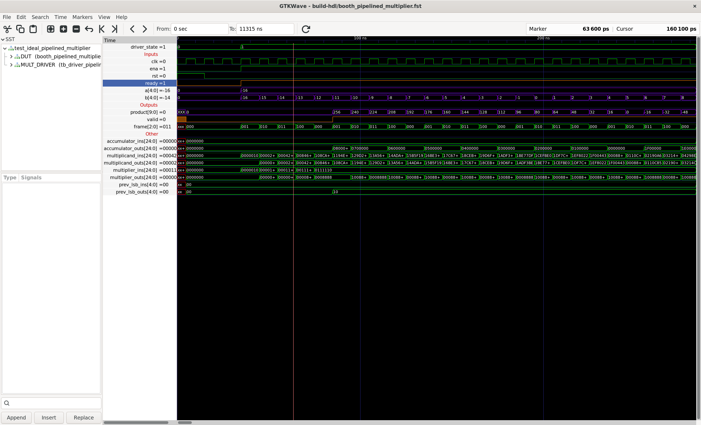
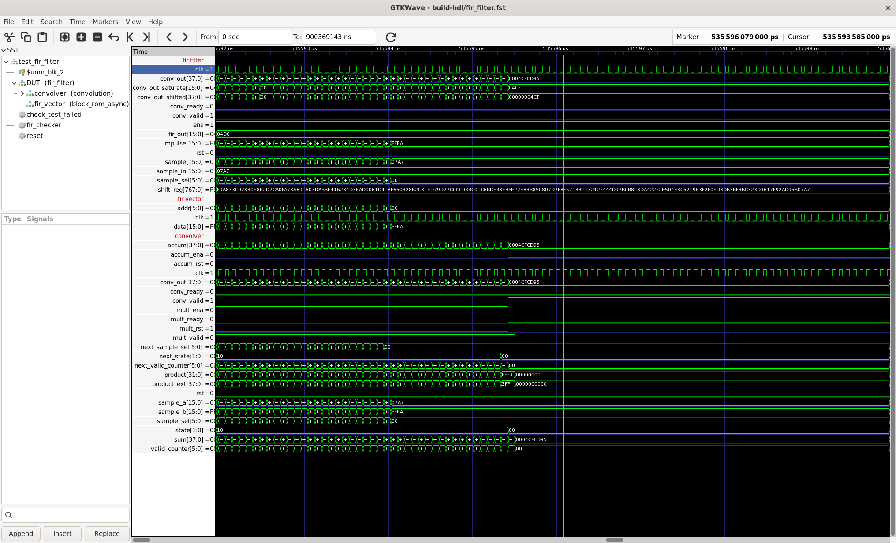

# FIR Audio Filter Project

Copy of my FIR audio filter project I made at Olin College of Engineering before
transferring to UMass Amherst. This was originally a team project; I was responsible
the system architecture, implementation of the multiplier and convolution unit,
and writing the script for simulation and synthesis.

# Repo Layout

- `./2024-olin-fir-auto-filter`: HDL, testbenches, and scripts.
- `./documentation-from-shared-drive`: Documents that were downloaded from our
  teams shared cloud drive. It is incomplete, but the information that is there
  is helpful for understanding our architecture and implementation.

# Waveforms

Waveform from the pipelined multiplier testbench. The testbench instantiates the
multiplier with the bit parameter set to five bits and runs through the times
table.

Waveform from the entire FIR filter system. The testbench runs 1 seconds worth
of audio samples through the filter and compares it to a pre-generated vector
made with SciPy.

